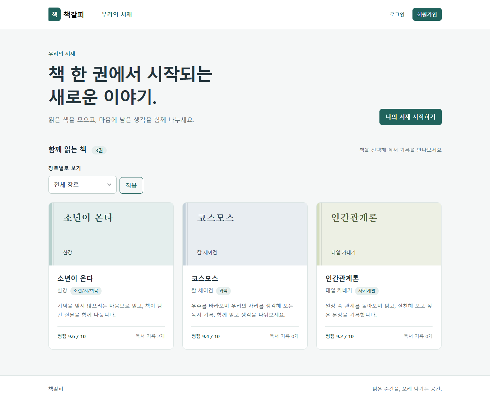
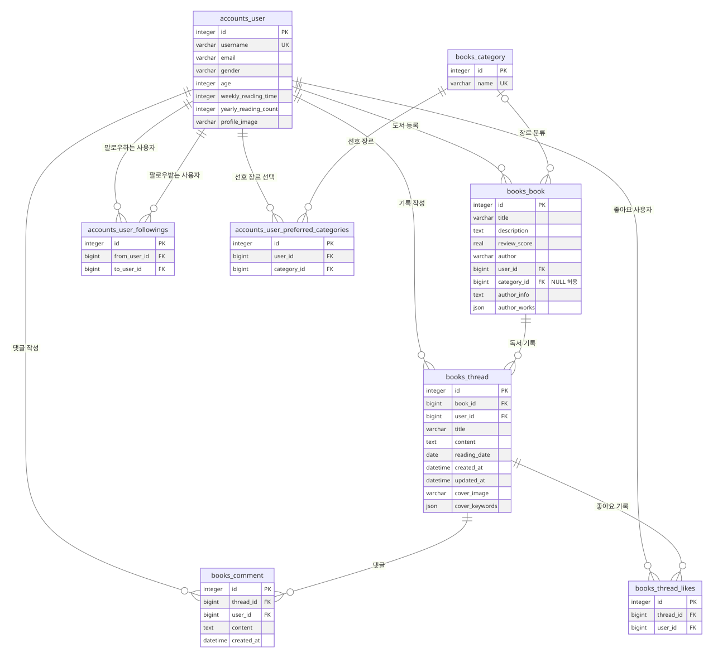

# 책갈피

[](https://github.com/whrjsgml3933/chaekgalpi/actions/workflows/ci.yml)

**책을 읽은 뒤의 생각을 기록하고, 다른 독자와 나누는 Django 커뮤니티**

개인 학습 프로젝트를 확장한 포트폴리오입니다. 회원·도서·독서 기록의 관계를 설계하고, 작성자 권한·입력 검증·AI 실패 처리까지 구현했습니다. 현재는 로컬에서 실행하는 시연 프로젝트이며 운영 배포나 실사용자 성과를 주장하지 않습니다.

- **범위:** Django 백엔드, SQLite 모델링, Templates·Bootstrap UI, 외부 API 연동, 테스트·문서화
- **개발 방식:** AI 도구를 구현·문서화에 활용하고 회귀 테스트와 실제 브라우저 검증으로 결과를 확인했습니다.
- **바로 실행:** API 키 없이 로컬 데모와 기본 기능을 확인할 수 있습니다.



## 핵심 기능

| 기능 | 동작 |
|---|---|
| 회원·프로필 | 가입·로그인·정보 수정·탈퇴, 사진·독서 정보·선호 장르, 비밀번호 변경 후 세션 유지 |
| 도서·독서 기록 | 작성자별 CRUD, 0~10점 평점, 넓은 카드 클릭 영역·키보드 이동 |
| 관계·대화 | 단방향 팔로우, 좋아요 토글, 댓글 작성·본인 댓글 삭제 |
| 장르 | 장르별 도서 필터, 선호 장르 다중 선택 |
| AI 작가 소개 | 이름·별칭·책 제목으로 위키피디아 후보 확인 후 소개·대표작 생성 |
| AI 커버 | 기록의 감정 키워드 5개·프롬프트를 만들고 생성 이미지를 파일과 DB에 저장 |

[작가 소개](docs/screenshots/author-info.png) · [독서 기록·댓글](docs/screenshots/reading-record.png) · [프로필](docs/screenshots/profile.png) · [장르 필터](docs/screenshots/genres.png) · [모바일](docs/screenshots/mobile.png)

화면의 계정·독서 기록은 시연 데이터입니다. 커버는 실제 AI 생성 결과이며 실제 책의 표지를 복제한 이미지가 아닙니다.

## 기술 스택

| 영역 | 구성 |
|---|---|
| 백엔드 | Python 3.11, Django 5.2.19 |
| 저장소 | SQLite3, Django ORM, 로컬 이미지 파일 |
| 화면 | Django Templates, Bootstrap 5.3.8, JavaScript |
| 외부 연동 | Wikipedia API, GMS 또는 OpenAI 호환 API |
| AI | gpt-5-nano, gpt-image-2 |
| 검증 | Django TestCase·SimpleTestCase, Playwright·Chrome, Ruff, GitHub Actions |

Bootstrap은 로컬 정적 파일로 포함합니다. 이미지 처리와 환경 설정에는 Pillow, python-dotenv를 사용합니다.

## 빠른 실행 — API 키 없이

저장소를 내려받은 뒤 Python 3.11 이상 환경에서 실행합니다. CI는 Python 3.11·3.12를 검증합니다.

```bash
git clone https://github.com/whrjsgml3933/chaekgalpi.git
cd chaekgalpi
```

### macOS / Linux

```bash
python3 -m venv .venv
source .venv/bin/activate
python -m pip install -r requirements.txt
python manage.py migrate
python manage.py seed_demo
python manage.py runserver
```

### Windows PowerShell

```powershell
python -m venv .venv
.\.venv\Scripts\python.exe -m pip install -r requirements.txt
.\.venv\Scripts\python.exe manage.py migrate
.\.venv\Scripts\python.exe manage.py seed_demo
.\.venv\Scripts\python.exe manage.py runserver
```

[http://127.0.0.1:8000/](http://127.0.0.1:8000/)에 접속합니다. `seed_demo`가 출력한 **demo_reader**와 임시 비밀번호로 로그인합니다. 도서 3개·독서 기록 1개·댓글 1개가 생성되며, 외부 API는 호출하지 않습니다.

명령을 다시 실행해도 데이터가 중복 생성되거나 기존 데모 계정 비밀번호가 초기화되지 않습니다. 같은 이름의 일반 계정이 이미 있으면 덮어쓰지 않고 중단하며, 비디버그 환경에서는 실행을 차단합니다.

데모에는 생성된 AI 결과를 넣지 않습니다. AI 기능은 선택한 경우에만 별도 키로 사용할 수 있고, 기본 CRUD·팔로우·좋아요·댓글·장르는 키 없이 동작합니다. 로컬 비밀키를 설정하지 않으면 임시 키를 사용하므로 서버 재시작 시 로그인 세션이 초기화될 수 있습니다.

## 환경 변수와 AI 설정

`.env.example`을 참고해 **`.env`**를 만듭니다. 실제 키는 예시 파일이나 소스에 넣지 않습니다.

```dotenv
DJANGO_SECRET_KEY=
DJANGO_DEBUG=true
DJANGO_ALLOWED_HOSTS=localhost,127.0.0.1,[::1]
DJANGO_CSRF_TRUSTED_ORIGINS=

GMS_API_KEY=
OPENAI_API_KEY=
AI_ENABLED=true
AI_IMAGE_MODEL=gpt-image-2
```

- GMS를 사용하면 `GMS_API_KEY`만 입력하고 `OPENAI_API_KEY`는 비웁니다. 직접 OpenAI를 사용하면 반대로 설정합니다. 둘 다 있으면 GMS를 우선합니다.
- AI를 사용하지 않으려면 `AI_ENABLED=false`로 설정합니다. 키가 없을 때도 AI 호출은 비활성화됩니다.
- 안정적인 로컬 세션을 위해 `DJANGO_SECRET_KEY`에 긴 무작위 값을 설정할 수 있습니다. 값은 아래 명령으로 생성하고 `.env`에서 따옴표로 감싸 보관합니다.

```bash
python -c "from django.core.management.utils import get_random_secret_key; print(get_random_secret_key())"
```

`DJANGO_DEBUG=false`에서는 50자 이상의 비밀키와 명시적인 허용 호스트가 필수이며, 와일드카드 호스트는 허용하지 않습니다. 이 모드에서는 HTTPS 리다이렉트와 보안 쿠키가 활성화됩니다. 실제 배포에는 HTTPS·WSGI/ASGI 서버·정적/업로드 파일 제공·모니터링을 별도로 구성해야 합니다. `runserver`를 운영 서버로 사용하지 않습니다.

## 데이터 구조



핵심 모델 5개와 M:N 중간 테이블 3개를 사용합니다. [전체 필드·고유 제약·삭제 동작](docs/erd.md)을 함께 정리했습니다.

- **N:1:** 사용자–도서, 사용자–독서 기록, 도서–독서 기록, 사용자–댓글, 독서 기록–댓글
- **M:N:** 사용자–사용자(팔로우), 사용자–독서 기록(좋아요), 사용자–장르(선호)
- 팔로우는 비대칭이며 중간 테이블의 FK 조합으로 중복 관계를 방지합니다.
- 평점은 폼·모델 검증으로 0~10점, 댓글은 최대 2,000자로 제한합니다. 모델 `save()`나 직접 SQL이 모든 검증을 자동 수행하는 것은 아닙니다.
- 장르 삭제 시 도서는 미분류로 유지하고, 기록 삭제 시 댓글·좋아요와 커버 파일을 정리합니다. 커버 파일 삭제는 트랜잭션 완료 후 수행합니다.

## 설계에서 신경 쓴 부분

### 1. 검색 결과의 순위와 인물 식별을 분리

이름이 문서 제목에 포함돼야 한다는 조건은 `인간관계론 / 카네키`처럼 성만 입력하거나 오타가 있는 경우 실패했습니다. 띄어쓰기·기호를 정규화하고, 별칭·다른 언어 이름을 비교하며 책 제목이 뒷받침되는 후보에 한해 유사 이름을 허용하도록 수정했습니다. 동명이인이 불확실하면 임의로 첫 결과를 고르지 않습니다.

**트레이드오프:** 잘못된 작가를 선택하는 것보다 일부 검색을 거절하는 쪽을 택했습니다. 위키피디아 검색 범위·조회 제한의 영향을 받으며 모든 오타·번역 제목을 해결하지는 못합니다.

### 2. 사용자가 쓴 데이터와 AI 생성 결과의 실패를 분리

도서·독서 기록을 먼저 저장하고 AI 생성 결과를 후속 처리합니다. 생성 실패가 원본 작성 실패로 이어지지 않으며 작성자만 재생성할 수 있습니다. 엄격한 JSON 형식, 키워드 수·타입, 이미지 바이트·형식을 검증하고 처리 중인 항목의 중복 생성을 제한합니다.

**트레이드오프:** 현재 요청은 동기 처리이므로 긴 생성 요청 동안 응답이 지연될 수 있습니다. 서버 작업이 중단되면 생성 중 상태의 복구도 추가로 설계해야 합니다.

### 3. 화면과 서버 양쪽에서 데이터·권한 규칙 확인

작성자·연결 도서는 검증된 폼 저장 후 서버에서 지정합니다. UI의 버튼 숨김과 별개로 view에서 로그인·작성자를 검사하고, 상태 변경은 POST·CSRF 검증을 사용합니다. 평점은 HTML의 min/max뿐 아니라 서버 폼·모델에도 범위를 적용했습니다.

구체적인 문제와 대안·검증은 [설계 결정과 문제 해결 기록](docs/decisions.md)에 정리했습니다.

## 검증과 CI

```bash
python -m pip install -r requirements-dev.txt
python -m ruff check .
python -m ruff format --check .
python manage.py check
python manage.py makemigrations --check --dry-run
python manage.py test
```

2026-11-05 기준 Windows·Python 3.11·Django 5.2.19에서 **자동 테스트 69개**, Ruff 검사·포맷, 마이그레이션 일치 검사와 키 없는 데모 브라우저 조작을 확인했습니다. GitHub Actions의 Ubuntu·Python 3.11/3.12에서도 각 69개 테스트와 모든 검증 단계가 통과했습니다.

기능 회귀 테스트 외에 환경 설정과 데모 데이터 재현성도 검사합니다. 외부 AI API는 자동 테스트에서 모의 처리하므로 유료 키가 필요하지 않습니다. 실제 GMS 호출과 브라우저 조작은 별도로 확인했으며 성능 수치·운영 지표로 제시하지 않습니다.

GitHub Actions는 Python 3.11·3.12에서 린트·포맷·Django 검사·마이그레이션 일치·전체 테스트·새 DB 데모 생성을 실행하도록 구성했습니다. [첫 공개 커밋의 CI 실행 기록](https://github.com/whrjsgml3933/chaekgalpi/actions/runs/41984266840)에서 두 Python 버전의 성공 결과를 확인할 수 있습니다. 상단 배지는 최신 실행 상태를 표시합니다.

## 코드 살펴보기

| 관심 영역 | 위치 |
|---|---|
| 모델·관계·평점 제약 | [books/models.py](books/models.py), [accounts/models.py](accounts/models.py) |
| 인증·작성자 권한·CRUD | [books/views.py](books/views.py), [accounts/views.py](accounts/views.py) |
| 위키 검색·AI 요청·응답 검증 | [books/services.py](books/services.py) |
| 커버 파일 삭제 시점 | [books/signals.py](books/signals.py) |
| 외부 API·검색 회귀 테스트 | [books/test_optional.py](books/test_optional.py) |
| 로컬 데모 명령 | [seed_demo.py](books/management/commands/seed_demo.py) |
| 자동 검증 | [CI workflow](.github/workflows/ci.yml) |

## 한계와 다음 개선

- SQLite·로컬 파일 저장을 사용하는 시연 프로젝트입니다. 운영 DB·파일 저장소·배포 구성은 포함하지 않습니다.
- AI 작업을 처리하는 큐·워커와 중단 작업 복구가 없습니다. 비동기 처리와 작업 상태 만료·재시도를 후속 과제로 남겼습니다.
- 로그인과 작성자 권한은 검사하지만 요청별 사용량 제한·생성 비용 한도는 아직 없습니다.
- 회원탈퇴·도서 삭제는 연결 기록을 연쇄 삭제할 수 있습니다. 공유 도서와 개인 작성 자료의 소유권 분리는 추후 설계 과제입니다.
- 목록 페이지네이션과 검색 후보 선택 UI는 구현하지 않았습니다.

교육용 비공개 명세서·제출 증빙·로컬 DB·API 키는 공개 대상에서 제외했습니다. 외부 자료와 시연 이미지의 출처는 [제3자 자료 안내](THIRD_PARTY_NOTICES.md)를 참고해 주세요.
