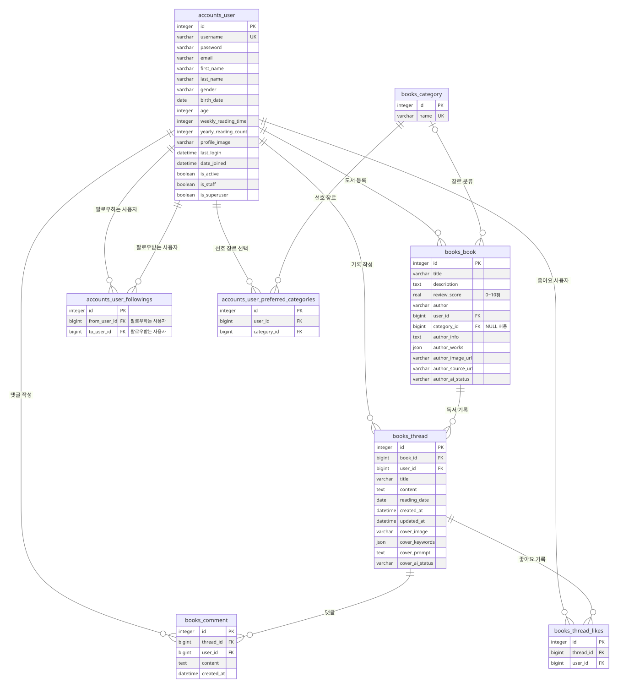
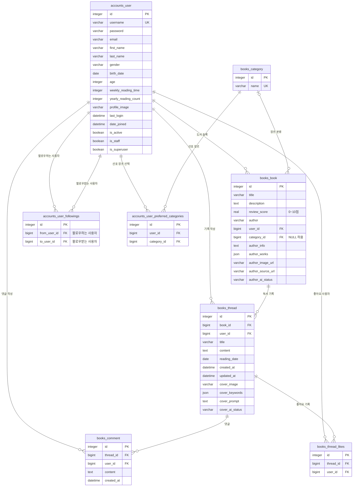

# DB ERD

2026-11-05 기준 실제 모델과 SQLite 스키마를 대조했습니다. 핵심 모델 5개와 Django가 생성한 M:N 중간 테이블 3개를 포함합니다. Django 내부의 권한·그룹·세션·관리자 로그 테이블은 생략했습니다.

[프로젝트 README로 돌아가기](../README.md)

## 전체 필드와 관계

전체 필드 Mermaid 원본 보기

## 관계 해설

| 부모·대상 | 연결 | 의미 |
|---|---|---|
| User → Book | 1:N | 사용자가 여러 도서를 등록하며 도서마다 등록자 1명이 있음 |
| User → Thread | 1:N | 사용자가 여러 독서 기록을 작성 |
| Book → Thread | 1:N | 한 도서에 여러 사용자의 독서 기록이 연결 |
| User → Comment | 1:N | 댓글마다 작성자 1명이 있음 |
| Thread → Comment | 1:N | 독서 기록마다 여러 댓글을 작성 |
| Category → Book | 1:N | 도서는 장르를 0개 또는 1개 선택하며 미분류를 허용 |
| User ↔ User | M:N | followings 중간 테이블로 방향이 있는 팔로우 표현 |
| User ↔ Thread | M:N | likes 중간 테이블로 좋아요 표현 |
| User ↔ Category | M:N | preferred_categories 중간 테이블로 여러 선호 장르 표현 |

## 고유 제약과 입력 규칙

- `accounts_user.username`, `books_category.name`은 각각 고유합니다.
- `accounts_user_followings`는 **(from_user_id, to_user_id)** 조합이 고유합니다. 각 FK가 개별적으로 고유한 것은 아닙니다.
- `books_thread_likes`는 **(thread_id, user_id)** 조합이 고유합니다.
- `accounts_user_preferred_categories`는 **(user_id, category_id)** 조합이 고유합니다.
- 팔로우는 `symmetrical=False`입니다. A가 B를 팔로우해도 B가 자동으로 A를 팔로우하지 않습니다. 자기 자신에 대한 팔로우는 view에서 막습니다.
- 평점은 모델 검증과 폼에서 0~10점으로 제한합니다. 모델의 `save()`나 직접 SQL이 모든 검증을 자동 실행하는 것은 아닙니다.
- 댓글의 최대 2,000자·빈 값 제한은 모델/폼 검증을 사용합니다.

## 삭제 동작

아래는 Django ORM에서의 `on_delete` 설정입니다.

- 사용자 삭제: 등록한 도서, 작성한 독서 기록과 댓글을 함께 삭제합니다. 등록한 도서를 통해 다른 사용자의 기록·댓글도 연쇄 삭제될 수 있습니다.
- 도서 삭제: 연결된 독서 기록·댓글과 좋아요 관계를 함께 삭제합니다.
- 독서 기록 삭제: 댓글·좋아요 관계를 삭제하고, 트랜잭션 완료 후 커버 파일을 정리합니다.
- 장르 삭제: 도서의 `category_id`를 NULL로 바꿔 도서는 유지합니다. 선호 장르 중간 관계는 정리합니다.

## 타입·저장 방식

- ERD의 `json`은 Django JSONField를 나타냅니다. SQLite의 실제 선언 타입은 TEXT이며 JSON 유효성 제약을 사용합니다.
- `profile_image`, `cover_image`에는 파일 자체가 아닌 경로를 저장합니다.
- `author_image_url`, `author_source_url`은 외부 자료의 URL입니다.
- `author_ai_status`, `cover_ai_status`는 미생성·생성 중·완료·실패 상태를 구분합니다.
- `birth_date`, `age`, `last_login`, `profile_image`는 NULL을 허용합니다. `category_id`도 NULL을 허용하며, 일부 문자열 필드는 빈 문자열을 허용합니다.
- `password`는 원문이 아닌 Django가 관리하는 해시 값입니다.

## 변경 반영 범위

사용자·도서·독서 기록·팔로우·좋아요에 댓글·장르·선호 장르 및 AI 결과 저장 필드를 포함합니다.
